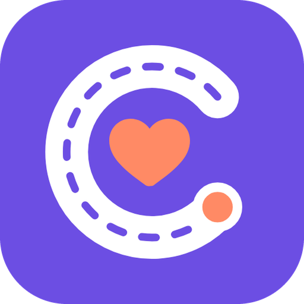
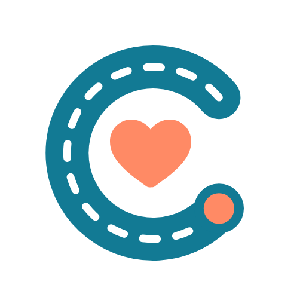

&nbsp;&nbsp;&nbsp;&nbsp;

<b>Family app</b> &nbsp;·&nbsp; <b>Caregiver app</b>

# CareWay

### Every journey, with care.

Affordable, trusted help to get residents **to and through** their medical visits, 
plus medicine delivered to the doorstep.

Team <b>Star3</b> · Universiti Sains Malaysia · Built for Sime Darby Property townships 
© 2026 Lew Jia Suen, Liew Choy Yein & Lim Huei Ching. All rights reserved.

---

## Contents

- 🏥 [The problem](#the-problem)
- 👨‍👩‍👧 [Who it is for](#who-it-is-for)
- 💡 [Our solution](#our-solution)
- ✨ [What makes it different](#what-makes-it-different)
- 🧠 [Smart matching and pricing](#smart-matching-and-pricing)
- 📚 [Sources](#sources)
- 🛠️ [Tech stack](#tech-stack)
- 🚀 [Try it (for testing)](#try-it-for-testing)
  - 🔑 [Test accounts](#test-accounts)
  - ▶️ [Getting started](#getting-started)
- 🌱 [Pilot plan](#pilot-plan)

---

## 🏥 The problem

> **Getting a parent to a routine check-up shouldn't cost a working adult a full day of leave, but today it often does.**

<table>
<tr>
<td align="center" width="25%"><h2>3.9M</h2>Malaysians are already 60 or older, and the number keeps climbing.</td>
<td align="center" width="25%"><h2>6 hrs</h2>How long a patient can wait at a busy public clinic.</td>
<td align="center" width="25%"><h2>RM 210</h2>What a private escort charges before the clock even passes 4 hours.</td>
<td align="center" width="25%"><h2>49.6%</h2>Roughly one in two working Malaysians is also caring for someone.</td>
</tr>
</table>

## 👨‍👩‍👧 Who it is for

- **Families** who book the visit and follow it from work
- **Patients** (older parents, children, OKU, people after surgery) who need a ride and someone beside them
- **Caregivers** from partner agencies who do the escorting and keep the family updated

## 💡 Our solution

Pick the amount of help the patient actually needs, and pay only for that.

| | Service | Price | What you get |
|:-:|---|---|---|
| 🚐 | **Group Saver** · Level 1 | **RM 22** / visit | Shared van and a group helper; ride home at the next scheduled return |
| ⚡ | **Group Flex** · Level 1 | **RM 35** / visit | Shared van and a group helper; ride home as soon as the patient is done |
| 🤝 | **Personal** · Level 2 | **RM 30** / hour + ride | One-to-one escort, door to door, who stays for the whole visit including the doctor's room; the private ride is priced by route by our [AI fee model](#smart-matching-and-pricing) |
| 💊 | **Medicine delivery** | **AI fee estimate** by route | Any pharmacy or hospital, a pickup window, and live tracking to the doorstep; priced from Malaysian courier rates ([how](#smart-matching-and-pricing)) |

**Included in every group visit:** ✅ Pre-registration · ✅ Help at registration · ✅ Queue tracking · ✅ Live family updates

**Optional add-ons:** Language help · Consult sit-in · Wheelchair · Medicine collection · Visit summary

Sample prices, to be tested in the pilot. Waiting time is never charged.

## ✨ What makes it different

<table>
<tr>
<td width="50%" valign="top">

**🧩 Pooled help** 
Neighbours share one van and one helper, so the cost is split.

</td>
<td width="50%" valign="top">

**🏘️ Built around the township** 
Rides are grouped by neighbourhood, hospital and time.

</td>
</tr>
<tr>
<td width="50%" valign="top">

**👪 One family view** 
Everyone in the family can book and see each visit.

</td>
<td width="50%" valign="top">

**📍 Medicine delivery** 
A helper brings the medicine home, with live tracking, at a fee our AI model learned from Malaysian courier prices.

</td>
</tr>
</table>

## 🧠 Smart matching and pricing

### 🤝 Personalised caregiver matching

Caregivers are matched with a **scoring model**. First, only caregivers who are on duty, nearby, free at that time and hold every skill and valid certificate the patient needs are kept. Each one is then scored for this family and patient: their rating, a shared language, past visits with the patient, the family's own ratings, extra skills that suit the patient (for example dementia care), and familiarity with the hospital. Distance and how busy they are that day lower the score. Caregivers the family rated poorly are left out. The highest score gets the job offer first.

### 💊 AI fee estimate

Medicine delivery and the Level 2 private ride are priced by an **AI fee model**: a linear regression trained on Malaysian courier and e-hailing prices (Grab, Lalamove, GrabExpress) for CareWay's real routes, with TomTom traffic data. It estimates the cost from the route distance and the time of day, so peak-hour trips cost more. The trained model is saved in [`functions/src/models/fee_model.json`](functions/src/models/fee_model.json) and used by both the server and the app.

## 📚 Sources

Prices and traffic data used to train the fee model (checked October 2026):

| Data | Figure used | Source |
|---|---|---|
| Grab Klang Valley e-hailing | RM 2 base + RM 0.25/km + RM 0.43/min, RM 5 minimum | [RinggitPlus](https://ringgitplus.com/en/blog/en/blog/apps/grab-implements-new-e-hailing-fares-rides-may-cost-more-during-peak-hours.html), [The Star](https://www.thestar.com.my/tech/tech-news/2023/01/16/grab-updates-fee-structure-rides-during-peak-hours-to-cost-more) |
| Kuala Lumpur traffic (TomTom Traffic Index 2025) | 10 km in 17 min 55 s on average (33.5 km/h); morning rush 28.8 km/h; evening rush 22.9 km/h; free flow about 48.5 km/h | [TomTom Traffic Index](https://www.tomtom.com/traffic-index/kuala-lumpur-traffic) |
| Lalamove motorcycle | From RM 5 + RM 0.70/km | [EasyParcel](https://blog.easyparcel.com/my/lalamove-rate/) |
| Lalamove waiting fee | 10 minutes free, then RM 2 per 5 minutes | [Lalamove Malaysia pricing](https://www.lalamove.com/en-my/all-vehicle-pricing-detail) |
| GrabExpress bike, Klang Valley | RM 1/km up to 20 km, RM 2/km beyond, RM 10 minimum | [RinggitPlus](https://ringgitplus.com/en/blog/personal-finance-news/grabexpress-delivery-service-now-available-in-the-greater-klang-valley-area.html) |
| Pharmacy waiting time | MOH KPI: 95% of prescriptions within 30 minutes; Hospital Ampang mean 34.8 minutes | [medRxiv](https://www.medrxiv.org/content/10.1101/2022.02.28.22271668.full.pdf), [Medical Journal of Malaysia](https://e-mjm.org/2024/v79s5/PP-40.pdf) |
| MOH Ubat Melalui Pos (comparison only) | RM 5.70 Peninsula before; free via MyUBAT from 1 Oct 2026 | [Malay Mail](https://www.malaymail.com/news/malaysia/2026/09/30/what-is-ump-how-malaysias-new-free-medicine-delivery-service-works-and-how-to-apply/236993), [MOH Pharmacy](https://pharmacy.moh.gov.my/en/content/ubat-melalui-pos-1malaysia-service.html) |

The Grab fare structure is from January 2023 and the GrabExpress rates from its 2019 Klang Valley launch, which are the latest public figures we found. Both apps now quote live prices, so retrain the model when newer rate cards or real trip data are available.

## 🛠️ Tech stack

| Part | What we use |
|---|---|
| 📱 **App** | Flutter: one app for Android and the web, with a family view and a caregiver view |
| ☁️ **Backend** | Firebase Authentication, Cloud Firestore and Cloud Functions |
| 🧠 **AI and matching** | Fee model (linear regression trained on Malaysian market prices) and personalised caregiver ranking, both in Cloud Functions |
| 🔔 **Notifications** | Firebase Cloud Messaging (push notifications on Android) |
| 🌐 **Hosting** | Firebase Hosting |

## 🚀 Try it (for testing)

### 👉 **[careway-tehwoq.web.app](https://careway-tehwoq.web.app/)** 👈

For testing purposes only. All data is demo data and no real money moves.

### 🔑 Test accounts

| | Role | Email | Password |
|:-:|---|---|---|
|  | **Family (guardian)** | `test@gmail.com` | `123456789` |
|  | **Caregiver** | `ravi@careway.demo` | `careway123` |

Every booking and medicine delivery goes to Ravi, so whatever you book as the family shows up in his caregiver app.

### ▶️ Getting started

1. Open **[careway-tehwoq.web.app](https://careway-tehwoq.web.app/)** in your browser.
2. Sign in as the family with `test@gmail.com`.
3. On the dashboard, tap **Book a visit**: choose who is going, the hospital, the date and time, then pick **Level 1 (Group)** or **Level 2 (Personal)** and pay.
4. Check **My visits** for upcoming, ongoing and past visits, or try **Medicine delivery** from the dashboard.
5. **Want to see the caregiver side too?** Sign in as `ravi@careway.demo` in another browser, a private window or on your phone. You'll see the job request arrive, and as Ravi taps through each step of the visit, the family view updates live.

## 🌱 Pilot plan

| When | Stage | What happens |
|---|---|---|
| Months 0 to 2 | 🔍 **Validate** | Interview residents; sign one caregiver agency and one hospital |
| Months 3 to 6 | 🧪 **Pilot** | Launch in one township (for example Elmina); track visits completed, leave days saved, on-time arrival and ratings |
| Months 7 to 12 | 📈 **Expand** | More townships, hospitals and caregiver partners |
| Year 2 | 🏡 **Embed** | Part of SDP township services, with hospital and insurer partners |

**Business model:** families pay per visit, caregivers are paid per group or per hour, and CareWay keeps a small platform fee on each booking.

---

**CareWay** · Every journey, with care.

